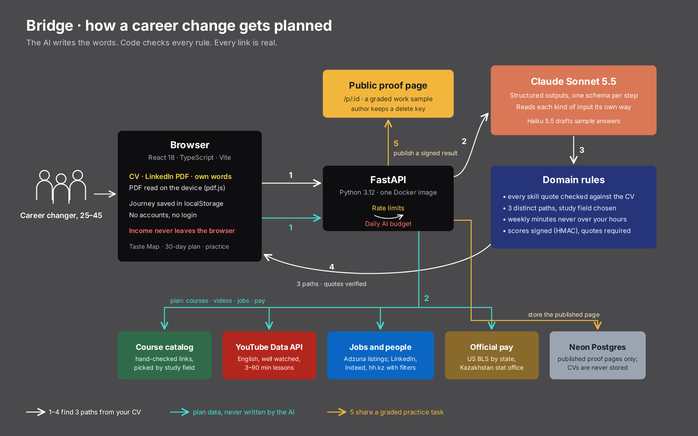
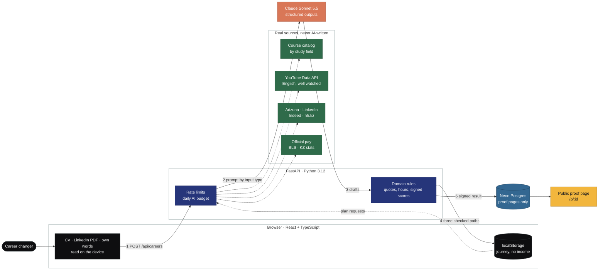

# Bridge

**Change careers without starting over.**

[](https://bridge-prod-xoqy.onrender.com)
[](https://www.python.org)
[](https://fastapi.tiangolo.com)
[](https://react.dev)
[](https://www.typescriptlang.org)
[](https://www.anthropic.com)
[](https://neon.tech)

Bridge helps working adults (25–45) who want a new career but do not know
where to go. You give it your CV, your LinkedIn profile or a few sentences in
your own words, plus your real week (free hours, budget, city). It gives back:

1. **Three paths that fit you, not your job title.** Each one names what you
   already do, quoted from your own text. Code checks every quote.
2. **A taste of each path.** A 10-minute task from each role, graded, then one
   question: would you enjoy this on a normal Tuesday? The Taste Map plots
   skill against energy and recommends a path.
3. **A 30-day plan that fits your hours.** Weekly tasks, a real course for the
   role, English YouTube lessons, and jobs, recruiters and pay where you live.
4. **Proof.** One click publishes a graded practice task as a public work
   sample you can send to a recruiter.

**Try it:** [bridge-prod-xoqy.onrender.com](https://bridge-prod-xoqy.onrender.com).
"Try the demo" needs no sign-up. Built for Business Cup 2.0 (AIESEC Astana ×
Zimran), November 2026.

---

### Architecture





---

### Why you can trust what it says

- **The AI writes words; code checks every rule.** Quotes must appear in your
  text, plans never exceed your hours, and scores carry a server signature.
  Each rule is a pure function in `backend/src/bridge/domain/` with a test.
- **Personal by design.** The prompt reads a CV, a LinkedIn export and your own
  words differently, weighs your reasons for changing and your constraints,
  and must name at least two details from your text in every path.
- **No invented links.** Courses come from a hand-checked catalog chosen by
  the role's study field (a music teacher is never sent to a programming
  course). Videos come from the YouTube API, filtered for English, views and
  length. Job and recruiter links are LinkedIn, Indeed and hh.kz searches
  with real filters.
- **Privacy.** Your CV is used for one request and never stored. Income never
  leaves the browser. LinkedIn profiles are never scraped: you export your own
  profile as PDF.

### Stack

| Layer | Choice |
|---|---|
| Front end | React 18, TypeScript (strict), Vite, TanStack Query, plain CSS |
| Back end | FastAPI, Python 3.12, uv, SQLAlchemy (async) |
| AI | Claude Sonnet 5.5 (paths, plans, grading), Haiku 5.5 (sample answers) |
| Data | Neon Postgres (proof pages only) |
| Quality | pytest, ruff, ty, import-linter, node:test, Playwright |
| Deploy | Docker on Render, deploys from `preprod` only after CI passes |

### Run it locally

Needs [uv](https://docs.astral.sh/uv/) and Node 24.

```bash
cd backend && uv sync && cp .env.example .env   # add ANTHROPIC_API_KEY, or leave empty for demo mode
uv run uvicorn bridge.main:create_app --factory --reload --port 8000
cd ../frontend && npm ci && npm run dev         # http://localhost:5173
```

Without an API key Bridge runs in **demo mode**: hand-written paths for the
sample CVs, labeled as samples on every screen.

### Tests

```bash
cd backend && uv run pytest                     # rules, AI client (mocked), full API flow
cd frontend && npm test                         # pure front-end logic
cd frontend && npm run build && BASE=http://localhost:8000 npm run e2e   # judge path, phone + desktop
BASE=http://localhost:8000 npm run qa           # deep QA: every input, country, link and reload
```

CI (`.github/workflows/ci.yml`) also runs the API tests on Postgres, an npm
audit and a Docker build.

### Configuration

Set in Render; names only, never values in git.

| Variable | Purpose |
|---|---|
| `ANTHROPIC_API_KEY` | Live AI. Without it: demo mode |
| `DATABASE_URL` | Neon connection string |
| `SECRET_KEY` | Signs practice tasks and scores (Render generates it) |
| `AI_CALLS_PER_DAY`, `AI_CALLS_PER_CLIENT` | Spending caps (defaults 400 a day, 40 per visitor per 10 min) |
| `YOUTUBE_API_KEY` | Optional: lesson videos on the plan |
| `ADZUNA_APP_ID`, `ADZUNA_APP_KEY` | Optional: live job listings |

### Repository

```
backend/src/bridge/   domain/ (rules) · llm/ (Claude + demo) · services/ · api/ · db/
frontend/src/         routes/ · components/ · lib/ (pure logic) · state/ · styles/
frontend/e2e/         walk.mjs (judge path) · qa.mjs (deep QA)
docs/                 architecture diagram
brand/                logo and icon kit
```

More: [`DESIGN.md`](DESIGN.md) (visual system), [`PRODUCT.md`](PRODUCT.md)
(product facts), [`CLAUDE.md`](CLAUDE.md) (code rules).
